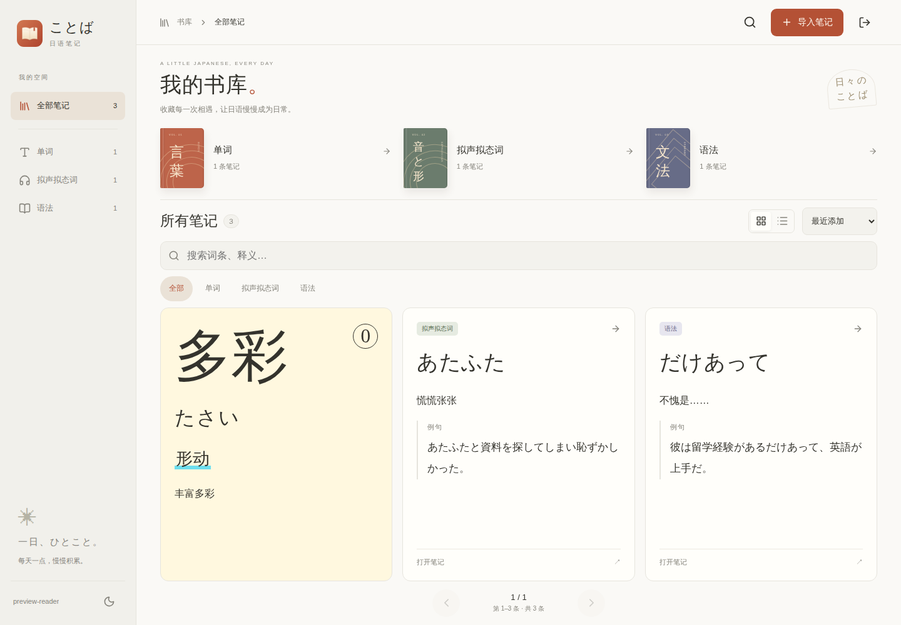
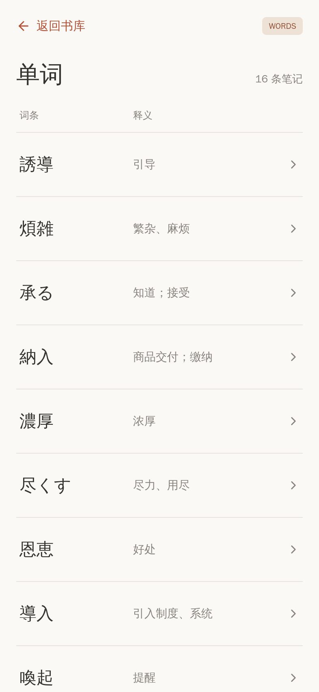
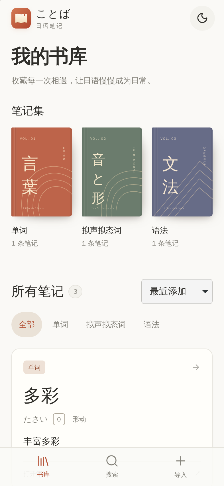
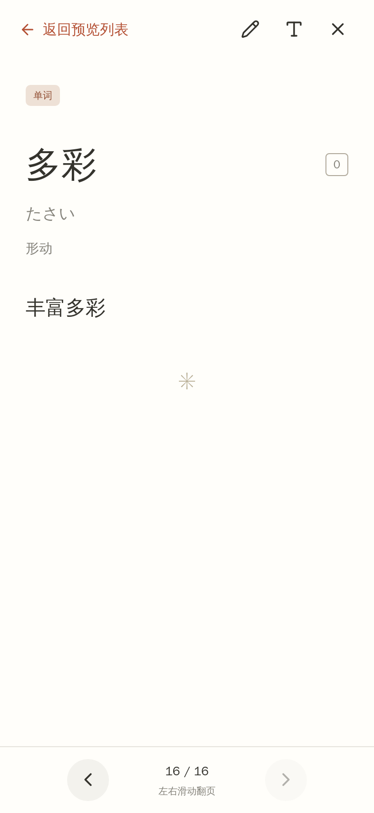
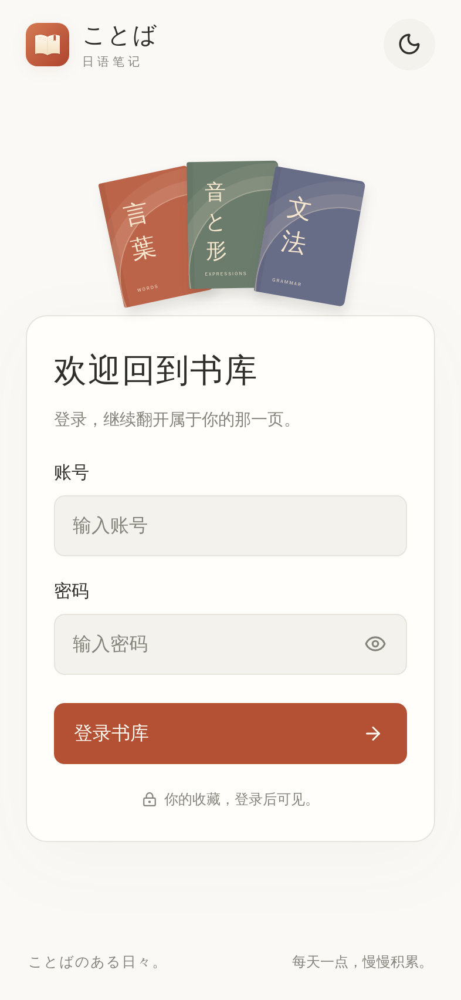

# ことば · Japanese Notes

一个适合慢慢阅读的日语笔记 Web App。以 Apple Books 的书架和阅读体验为参考：暖纸色背景、衬线日文字体、三本不同颜色的笔记集，以及浅色 / 深色主题。

React + TypeScript + Vite 构建界面；Cloudflare Worker 提供 API 和静态文件；Cloudflare D1 持久保存笔记。通过 Cloudflare 连接此 GitHub 仓库，推送 `main` 后自动部署。



## 已实现

- **账号登录**：账号与密码由 Cloudflare 运行时环境变量配置，登录后阅读与导入，支持退出和会话保留。
- **单词**：词条、平假名读音、声调数字（含 `0` 调）、词性、中文释义，可选例句。
- **拟声拟态词**：词条、中文释义、日语例句。
- **语法**：语法表达、中文释义、日语例句。
- 首页书本入口打开可上下滚动的「词条 / 释义」预览列表，点击任意行进入可左右滑动的阅读页。
- 固定屏幕的首页卡片、搜索、排序与分页，卡片数量按可用空间调整。
- 手机、平板、桌面布局；深色主题和显示方式保存在当前浏览器。
- 粘贴 JSON 或选择 `.json` 文件，分步输入、逐条预览，再批量上传。
- 整批校验、事务写入、自动跳过完全重复的笔记，并返回新增 / 跳过数量。

首次数据库迁移会加入项目需求中的三条示例：`多彩`、`あたふた`、`だけあって`。后续部署不会再次加入示例，也不会清空已有笔记。

## 单屏书库与滑动翻页

点击首页的「单词 / 拟声拟态词 / 语法」书本，会先打开对应的预览列表：每行左侧为 `term`，右侧为 `meaning`，列表可上下滚动。长词条和释义显示摘要，点击一行查看完整内容；未填写释义时不生成占位内容。笔记较多时，滚动到底部会自动继续加载，也可点击「加载更多词条」。

进入词条后，左滑下一条、右滑上一条，顺序沿用打开书本时的排序，且可以跨越列表加载批次。点击「返回预览列表」会保留原来的滚动位置。浏览器返回也按「词条 → 预览列表 → 首页」逐级返回。



首页、搜索、登录与导入采用固定屏幕布局，不产生整页的上下滚动条。不同屏幕会自动调整每页显示的卡片数，使用底部页码和左右按钮切页，也可以在卡片区域左右滑动。卡片中的长词条、释义和例句会收起，点击后在阅读页查看完整内容。

单词与拟声拟态词、语法采用一致的卡片底色、衬线词头和标签风格。排列保持「词条与右侧声调 → 平假名读音 → 词性 → 中文释义 → 例句」，声调使用小标签，读音和词性使用柔和的辅助文字。词性直接显示输入内容，例如 `名·形动`。


阅读页的操作：

- **左滑下一条、右滑上一条**，纸页随手势移动，并有翻页过渡和阴影；也可点击左右按钮，或使用键盘左右方向键。
- 连续阅读当前分类、关键词和排序下的全部笔记，可以跨越书库列表的分页。
- 阅读页仅当前词条的完整正文可纵向滚动，翻到下一条会从顶部开始。从书本列表进入时，关闭阅读返回原列表位置；从首页卡片进入时，关闭阅读定位到当前词条所在的卡片页。
- 支持浏览器返回退出阅读，以及阅读字号记忆。系统开启「减少动态效果」时会直接切换内容。
- JSON 导入使用「输入 → 逐条预览 → 上传」三个步骤。编辑框有独立的编辑区域，预览时一次显示一个词条。

## iPhone 与添加到主屏幕

针对 iPhone 优先设计：底部「书库 / 搜索 / 导入」导航、44px 以上的主要触控区域、放大的词条 / 释义 / 例句，以及整屏纸页阅读。较长的同一词条正文单独滚动，顶部关闭与底部翻页控件固定；大字号设置会保留。刘海、横屏左右边缘和底部手势区通过安全区适配，输入框使用至少 16px 字号。

 

添加方法：

1. 在 iPhone 的 Safari 中打开部署后的 **HTTPS** 网址。
2. 点击「分享」→「添加到主屏幕」，名称可保留为「日语笔记」。如果系统显示「作为 Web App 打开」，请开启。
3. 点击「添加」，以后从主屏幕图标进入，会以独立窗口打开。

已提供 180px 的 Apple Touch Icon、192px / 512px 的 Web App 图标、独立的 maskable 图标、Safari 固定标签页图标以及 SVG / PNG / ICO 标签页图标。图标来自项目自带的书本矢量稿；iOS 会应用系统的图标圆角。已添加旧快捷方式时，可移除旧图标后重新添加，以获取更新后的图标。

首次启动跟随系统的浅色 / 深色偏好，也可以点击页面右上角切换；后续启动保留手动选择。应用通过联网访问 D1 读取、导入笔记。

浏览器测试覆盖 WebKit 引擎的 320 / 375 / 393 / 430px iPhone 模拟视口、横屏、模拟安全区、无整页滚动、书本预览列表滚动与继续加载、跨列表页阅读、返回列表位置保留、长例句滚动、字号保留、导入以及图标文件尺寸；另外使用真实触摸事件验证横向翻页和纵向正文滚动。这些是模拟测试，不代表已经在实体 iPhone 上逐项验证系统状态栏和软件键盘。

图标源文件：[public/icons/app-icon.svg](./public/icons/app-icon.svg)。需要更新图标时，修改矢量稿后运行：

```bash
npx playwright install chromium
npm run icons
```

参考：[Apple 的添加主屏幕说明](https://support.apple.com/guide/iphone/open-as-web-app-iphea86e5236/ios)、[WebKit 安全区说明](https://webkit.org/blog/7929/designing-websites-for-iphone-x/)。

## 连接 GitHub 部署到 Cloudflare

这是一套 **Workers + Static Assets + D1** 应用。请创建 **Worker**，使用 Cloudflare 的 GitHub 集成部署。

### 1. 创建 D1 数据库

在 Cloudflare 控制台的 **Storage & databases → D1 → Create database** 中创建：

```text
japanese-notes-db
```

复制数据库的 **Database ID**。编辑仓库根目录的 [wrangler.jsonc](./wrangler.jsonc)，将全零占位值替换为这个 ID，并提交到 `main`：

```jsonc
"d1_databases": [
  {
    "binding": "DB",
    "database_name": "japanese-notes-db",
    "database_id": "这里填写真实的 Database ID",
    "migrations_dir": "migrations"
  }
]
```

绑定名必须是 `DB`。数据库名称如有修改，也请同步修改配置。Database ID 是资源标识，可以提交到仓库；登录账号与密码请按第 3 步配置。

### 2. 连接 GitHub 并部署

进入 **Workers & Pages → Create application → Import a repository / Connect GitHub**，选择 `jiojioinjapan-png/Japanese-notes`。

按下表设置：

| 配置项         | 值                                                              |
| -------------- | --------------------------------------------------------------- |
| Worker 名称    | `japanese-notes`（与 `wrangler.jsonc` 中的 `name` 一致）        |
| 生产分支       | `main`                                                          |
| 根目录         | 仓库根目录 `/`                                                  |
| Build command  | `npm run build`                                                 |
| Deploy command | `npm run deploy`                                                |
| Node.js        | `22` 或更新的 LTS；如需显式指定，添加构建变量 `NODE_VERSION=22` |

Cloudflare 会根据 `package-lock.json` 安装依赖。`npm run deploy` 会先对远程 D1 应用尚未执行的迁移，再部署 Worker 与前端文件。每次推送 `main` 都会重新执行这个流程。

构建使用的 Cloudflare API token 需要目标账户的 **D1 Edit** 和 **Workers Scripts Edit** 权限；如果迁移出现权限错误，在 Worker 的 **Settings → Build → API token** 中选择具有这些权限的 token。

此配置连接生产 D1。先仅启用 `main` 的生产部署；如果要开启其他分支的预览，请为预览单独配置 Worker / D1，以免预览使用生产数据。

### 3. 设置登录账号与密码

在 Worker 的 **Settings → Variables and Secrets** 中添加以下两个 **运行时环境变量**：

| 名称             | 值                   | 建议类型       |
| ---------------- | -------------------- | -------------- |
| `LOGIN_USERNAME` | 你希望使用的账号     | Text 或 Secret |
| `LOGIN_PASSWORD` | 你自己设置的较长密码 | **Secret**     |

保存并应用配置（控制台提示部署时完成部署）。项目已配置 `keep_vars: true`，后续 GitHub 自动部署会保留控制台设置的普通环境变量；Secret 也会保留。这两个值只由 Worker 服务端读取，不能设置成 `VITE_*`，也不应写进仓库。Cloudflare 的 Text / Secret 类型都可通过 `env` 读取；密码建议选择 Secret。

打开部署生成的 `https://japanese-notes.<你的子域>.workers.dev`，会先看到登录页。使用上述账号密码登录后，即可阅读和批量导入，**无需再输入导入密钥**。旧版的 `ADMIN_TOKEN` 不再使用，可以从环境变量中删除。



登录行为：

- 这是由一组环境变量配置的单账号书库。账号与密码区分大小写，密码首尾空格也参与校验。
- 登录会话保留 **30 天**，适合从 iPhone 主屏幕再次打开；会话过期后需要重新登录。
- 右上角可「退出登录」，服务端会立即撤销该会话。刷新页面或再次打开应用会检查会话状态。
- 修改任意一个登录环境变量并应用后，已有会话会失效，需要用新账号密码登录。
- 未登录时，所有笔记读取与导入 API 都返回 `401`；缺少任意一个配置时返回 `503`，不会开放笔记。
- 生产会话使用 `Secure`、`HttpOnly`、`SameSite=Lax` Cookie，D1 仅保存随机会话令牌的哈希与验证信息；账号密码不会发送进前端配置，也不会写入浏览器本地存储。
- 同一 IP 在 15 分钟内连续尝试错误账号密码超过 10 次，会暂时限制登录，并返回 `429`。

本次新增 [0002_authentication.sql](./migrations/0002_authentication.sql) 迁移。保持部署命令为 `npm run deploy`，会自动创建会话与登录次数记录表，已有笔记会保留。

## JSON 导入格式

根对象只有一个 `notes` 数组，可以在同一批中混合三种笔记。**每条只有 `type` 和 `term` 必填，其他字段都可省略、填写 `null`、空字符串 `""` 或纯空白字符串。** 最简示例：

```json
{
  "notes": [
    { "type": "word", "term": "ある" },
    { "type": "onomatopoeia", "term": "きっぱり", "accent": 3, "partOfSpeech": "副" },
    { "type": "grammar", "term": "にとって", "meaning": "", "example": null }
  ]
}
```

包含完整内容的示例：

```json
{
  "notes": [
    {
      "type": "word",
      "term": "多彩",
      "reading": "たさい",
      "accent": 0,
      "partOfSpeech": "形动",
      "meaning": "丰富多彩"
    },
    {
      "type": "onomatopoeia",
      "term": "あたふた",
      "meaning": "慌慌张张",
      "example": "あたふたと資料を探してしまい恥ずかしかった。",
      "exampleTranslation": "慌慌张张地找资料，觉得很不好意思。"
    },
    {
      "type": "grammar",
      "term": "だけあって",
      "meaning": "不愧是……",
      "example": "彼は留学経験があるだけあって、英語が上手だ。",
      "exampleTranslation": "他不愧有过留学经历，英语说得很好。"
    }
  ]
}
```

上例也保存在 [examples/notes.json](./examples/notes.json) 中。界面中的「填入示例」使用三条完整示例。

| 字段                 | 类型   | 要求                                                                           |
| -------------------- | ------ | ------------------------------------------------------------------------------ |
| `type`               | 字符串 | 必填。`word` 单词 / `onomatopoeia` 拟声拟态词 / `grammar` 语法                 |
| `term`               | 字符串 | 必填且不能为空，最多 200 字符                                                  |
| `meaning`            | 字符串 | 可选，中文释义，最多 2000 字符                                                 |
| `reading`            | 字符串 | 可选，平假名读音，最多 200 字符；允许长音符号 `ー`、间隔号 `・` 和空格         |
| `accent`             | 数字   | 可选，`0`～`99` 的整数，`0` 表示平板型；未知时留空，请勿填 `-1` 或字符串 `"0"` |
| `partOfSpeech`       | 字符串 | 可选，如 `名`、`动`、`形`、`形动`，最多 100 字符                               |
| `example`            | 字符串 | 可选，日语例句，最多 2000 字符                                                 |
| `exampleTranslation` | 字符串 | 可选，例句中文翻译，最多 2000 字符                                             |

规则：

- 每批 **1～500 条**，JSON 的 UTF-8 大小不超过 **1 MiB**；超出时请拆成多批。
- `type` 和 `term` 不能为空。其他字段省略、`null`、空字符串与纯空白字符串都视为未填写，不会自动补写内容；未知声调不会当成 `0` 调，页面也不会显示空标签或 `-1`。
- 三类笔记均可使用表中所有字段，例如拟声拟态词也可以填写声调和词性，内容会保存并显示。字段名区分大小写；未知字段、非空字段的类型和长度错误仍会报错，避免拼写错误或数据丢失。
- 内容会去除首尾空白，并进行 Unicode NFC 规范化；正文和例句中的换行会保留。
- 任何一条数据不合法，**本批全部不写入**，错误会标出第几条笔记及字段。数据库执行失败时，整个事务回滚。
- 所有内容字段完全相同时才视为重复。同词条的不同释义、声调、词性、例句或例句翻译会新增一条，不会覆盖旧笔记。并发上传也由数据库唯一索引保证去重。
- 上传成功后，书库和分类计数会自动刷新。笔记保存在 D1，可跨浏览器、跨设备访问。

使用方法：点击「导入笔记」→ 粘贴 JSON 或选择文件 → 检查格式 → 点击「预览笔记」逐条确认 → 点击「上传笔记」。请先登录书库。

## 本地开发

需要 Node.js `>=22.12.0`。

```bash
npm ci
cp .dev.vars.example .dev.vars
```

修改 `.dev.vars` 中的 `LOGIN_USERNAME` 与 `LOGIN_PASSWORD`，然后初始化本地 D1：

```bash
npm run db:migrate
npm run build
npm run dev:worker
```

打开 `http://localhost:8787`。本地 D1 保存在 `.wrangler/`，不会改动线上数据库。仅本地运行时可以保留全零的 Database ID。

前端开发如需热更新，保持 Worker 运行，再开一个终端：

```bash
npm run dev
```

打开 Vite 输出的网址。开发时 `/api` 会代理到 `127.0.0.1:8787`；生产环境由同一个 Worker 提供静态资源与 API。

验证：

```bash
npm run check
npm test
npx playwright install --with-deps chromium webkit
npm run test:e2e
```

集成测试在独立的 Miniflare D1 中验证实际 SQL、500 条导入、去重和事务回滚。浏览器测试会自动构建并启动本地 Worker，每次重建 `.wrangler/e2e` 的独立测试数据库，使用公开的测试专用账号密码，不影响开发 / 生产数据库。GitHub Actions 会自动运行测试与构建。

## API

| 请求                     | 用途                                                                     |
| ------------------------ | ------------------------------------------------------------------------ |
| `POST /api/auth/login`   | JSON `{ "username": "账号", "password": "密码" }`；成功后设置会话 Cookie |
| `GET /api/auth/session`  | 检查会话；已登录时返回账号名，未登录时不泄露配置的账号                   |
| `POST /api/auth/logout`  | 撤销当前会话并清除 Cookie                                                |
| `GET /api/notes`         | **需登录**；分页读取笔记，并返回各分类总数                               |
| `POST /api/notes/import` | **需登录**；批量导入，要求 `Content-Type: application/json`              |

浏览器通过同源 HttpOnly Cookie 自动保持认证。脚本调用时，请先请求登录接口并保留返回的 Cookie，再请求笔记 API；旧的 Bearer 导入密钥不能代替登录。所有动态 API 响应均不缓存。

读取接口的可选参数：`category=all\|word\|onomatopoeia\|grammar`、`q=关键词`（最多 200 字符）、`sort=recent\|oldest\|term`、`page=1`、`pageSize=24`（范围 1～100）。关键词匹配词条、读音、词性、中文释义、例句与翻译；`%`、`_` 等按普通文字处理。`term` 排序使用数据库字符顺序。

导入成功返回 HTTP `201`：

```json
{ "inserted": 10, "skipped": 2, "total": 12 }
```

错误状态：`400` JSON / 字段 / 参数错误，`401` 账号密码错误或会话无效，`403` 跨站请求，`413` 超出大小限制，`415` 非 JSON 内容类型，`429` 登录尝试过多，`503` 尚未设置登录账号密码。服务端也会重复验证输入，不能通过绕过浏览器检查写入非法笔记。

## 项目结构

```text
src/                     固定屏幕书库、iPhone 布局、滑动与导入交互
src/components/         书本预览列表、单词排版、纸页阅读器、导入与弹窗
src/useShelfLayout.ts   按可用空间计算每页卡片数量
src/useSwipe.ts         横向手势识别，保留纵向滚动和缩放
shared/notes.ts          三类笔记的数据类型和前后端共享校验
worker/index.ts         笔记 API、D1 查询与事务导入
worker/auth.ts          登录、会话撤销、环境变量校验与限流
src/AuthGate.tsx        登录界面与会话状态管理
migrations/             D1 数据库迁移与首次示例数据
examples/notes.json      可上传的 JSON 示例
public/                  主屏幕 manifest、图标及静态资源
scripts/                 图标生成和隔离测试服务器
tests/                  输入校验、真实 D1 集成测试、浏览器测试
wrangler.jsonc          Worker、静态资源与 D1 绑定配置
.github/workflows/      GitHub 自动检查
```

Cloudflare 参考文档：[Git 构建配置](https://developers.cloudflare.com/workers/ci-cd/builds/configuration/)、[静态资源与 SPA 路由](https://developers.cloudflare.com/workers/static-assets/routing/single-page-application/)、[D1 迁移](https://developers.cloudflare.com/d1/reference/migrations/)、[Worker 运行时 Secrets](https://developers.cloudflare.com/workers/configuration/secrets/)、[Wrangler 环境变量保留配置](https://developers.cloudflare.com/workers/wrangler/configuration/)。
